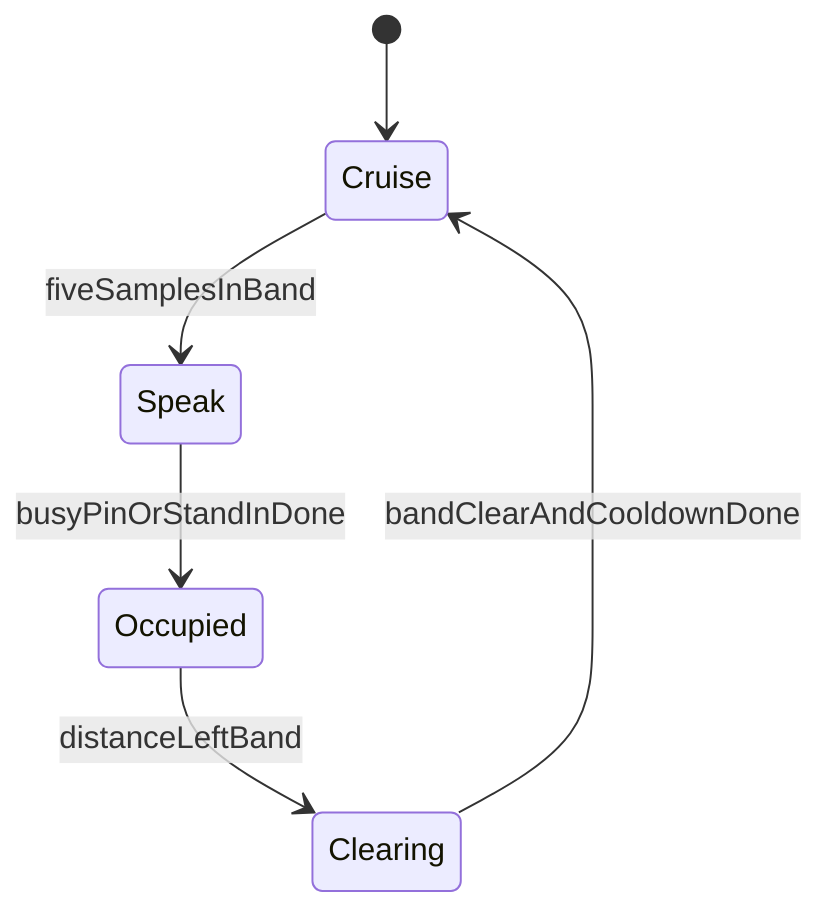

# Chassis is still out. The player is here.

Today is Thu Nov 19. The four TT motors ship with the Hiwonder chassis, and that box has not arrived, so there is nothing to roll. The DFPlayer Mini is here: DFRobot DFR0299, Mouser 426-DFR0299, and KEMET ESH108M016AH2AA capacitors (1000 µF, 16 V, 105 °C, radial). [P3_Spec.md](P3_Spec.md) is still only a title, so this follows [P3_proposal.md](P3_proposal.md).

In hand: both Nucleos, VL53L1X, SSD1306 OLED, STEMMA cables, TB6612, SG92R servo, microSD, speaker, DFPlayer Mini, the 1000 µF capacitors, and power (AA holder and/or the USB bank). The speaker connects to the player's SPK1 and SPK2. Do not wire the speaker to a Nucleo pin, and do not tie either speaker wire to ground. The Adafruit 1313 speaker (8 Ω, 1 W) is in the range this module can drive.

The pin map and function API stay as they are. Build one CubeIDE project, copy the 80 MHz clock from P2, and keep printf on PA2/PA3. Timers stay register-level. No delay loops for the sample period or the servo.

## Do this now

Luis, on their own Nucleo. This is the critical path.

- [x] I2C1 on PB8 (D15) and PB9 (D14). Scan the bus. Pass is `0x29` (VL53L1X) and `0x3D` (OLED) on the same chain. The STEMMA boards already have pull-ups. This OLED answers at `0x3D` because SA0 is strapped high.
- [x] Wrap ST’s VL53L1X ultra lite driver and print millimeters on USART2. Long range is on. A hand moving toward the sensor is the test.
- [x] `oled_show_line` with one short string, the same text you will later store next to each clip.
- [x] Tape-measure table at 20, 40, 60, 80, and 100 cm, in `band.h`. Locked from the printed millimeters: `STOP_NEAR_MM` 235, `STOP_FAR_MM` 520.
- [ ] Ignore readings under 80 mm. Require 5 samples in a row, 50 ms apart, before a trigger.
- [ ] `affirmations.c`: 8 to 12 lines, each with a track number.
- [ ] On a computer, format the microSD FAT32 and put `mp3/0001.mp3` onward on it.
- [ ] `audio_play_track` logs the DFPlayer command bytes to USART2 and sends them on USART1.
- [ ] Wire the player. `audio_is_busy` reads PB5. Until that wire is on, the 3-second stand-in is enough to keep the state machine moving.

DFPlayer wiring, sensor partner:

- PA9 (USART1 TX, D8) to player RX. The L476 pin is 3.3 V, which this module accepts.
- PA10 (USART1 RX, D2) from player TX through a divider. PA9 and PA10 are not 5 V tolerant.
- PB5 (D4) to BUSY. BUSY stays high while a clip is playing.
- Player VCC from 5 V: Nucleo 5 V while USB is plugged in, or the power bank. Not the 3.3 V pin.
- One ESH108M016AH2AA across the player's VCC and GND, as close to those two pins as the leads allow. The stripe goes to GND. 16 V is the capacitor's maximum rating, and this rail is 5 V. The other capacitors are spares. The stripe on VCC vents the can.
- Speaker on SPK1 and SPK2. Player GND tied to Nucleo GND.
- The capacitor covers the amplifier's current spikes. A loud clip plus the servo is happier on the power bank than on the Nucleo USB 5 V pin.

Andres, on their own Nucleo. Still no motors.

- [ ] Servo on PA8 (D7), TIM1, `PSC = 79`, `ARR = 19999` (50 Hz, 1 µs tick). Pulse 1000 to 2000. `servo_start_wave` sweeps that range from the timer. Power the servo from 5 V (Nucleo 5 V while USB is plugged in, or the power bank), not from 3.3 V. The signal wire is 3.3 V and that is fine for the SG92R.
- [ ] TB6612 with no motor attached. VMOT from the AA pack only, VCC from Nucleo 3.3 V, grounds tied, 10k pulldown on STBY (PB6, D10). PWM on PA6 and PA7 at 20 kHz (`PSC = 0`, `ARR = 3999`). Direction pins PB3, PB4, PB10, PC7. Pass is a multimeter on AO1/AO2 and BO1/BO2: direction flips the polarity, duty changes the voltage, STBY low makes both outputs float. Do not short the outputs and do not command them into a dead short.
- [ ] `drive_set_speed` and `drive_stop` are real functions. With no motors they only change those pins. Printf the left and right percent on USART2 so the state machine is visible.

Together, Friday Nov 20, one Nucleo. This is the stand-in for the rover demo.

- [ ] Hand enters the calibrated band: motors commanded stop (watch the meter or the printf), OLED shows one affirmation, servo waves once, the player speaks that track, and a second hand-wave during the clip does not start another line.
- [ ] Hand leaves, the band stays clear about 500 ms, and a later entry is allowed to trigger again.
- [ ] `rover.c` calls `audio_play_track` / `audio_is_busy` and `drive_set_speed`. It does not contain a special case for the missing chassis. Swapping in the real motors later is a driver change, not a state-machine rewrite.
- [ ] If the player is not on this Nucleo yet, `audio_is_busy` may still be the 3-second stand-in. The OLED line and the track number stay paired either way.

## Parked until the chassis shows up

Chassis day, drive partner, first hour: wire two motors in parallel on each TB6612 channel, same direction on a side, mount the boards, then set `LEFT_SCALE` and `RIGHT_SCALE` on the floor. If a side twitches, one plug is backward.

Do not start the IMU or a second distance sensor. I2C and a spare USART stay free, as the proposal said.

## After this week

Mon Nov 23 and Tue Nov 24 are the last hardware days before Thanksgiving. If the chassis is here, that is the tethered drive-and-stop test. If it is not, keep the bench demo solid and use those days on ranging noise, the servo sweep, and a full clip on the player.

Week of Nov 30 is still the untethered check (AA pack for VMOT only, power bank for the Nucleo) and one full interaction, including sound. Week of Dec 7 is rehearsal: each partner shows their own part, then one full run. Demo lab is Dec 7–11.
