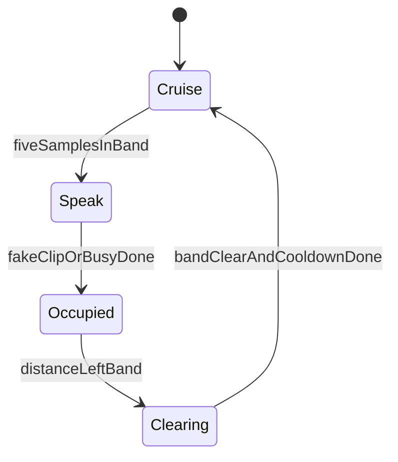

# What to do while the chassis and DFPlayer are out

Today is Tue Nov 17. [README.md](README.md) assumed those parts might show up this week. They have not. The four TT motors ship with the Hiwonder chassis, so there is nothing to roll. There is also nothing to play audio through. [P3_Spec.md](P3_Spec.md) is still only a title, so this follows [P3_proposal.md](P3_proposal.md).

In hand: both Nucleos, VL53L1X, SSD1306 OLED, STEMMA cables, TB6612, SG92R servo, microSD, speaker, and power (AA holder and/or the USB bank). The speaker stays in the box until the DFPlayer arrives. Do not wire it to a Nucleo pin.

The pin map and function API in the README stay as they are. Build one CubeIDE project, copy the 80 MHz clock from P2, and keep printf on PA2/PA3. Timers stay register-level. No delay loops for the sample period or the servo.

## Do this now

Luis, on their own Nucleo. This is the critical path, and none of it needs the missing parts.

- I2C1 on PB8 (D15) and PB9 (D14). Scan the bus. Pass is `0x29` (VL53L1X) and `0x3C` (OLED) on the same chain. The STEMMA boards already have pull-ups.
- Wrap ST’s VL53L1X ultra lite driver and print millimeters on USART2. A hand moving toward the sensor is the test.
- `oled_show_line` with one short string, the same text you will later store next to each clip.
- Tape-measure table at 20, 40, 60, 80, and 100 cm. Lock `STOP_NEAR_MM` and `STOP_FAR_MM`. Starting guess until that table exists: 300 to 800 mm, ignore readings under 80 mm. Require 5 samples in a row, 50 ms apart, before a trigger.
- `affirmations.c`: 8 to 12 lines, each with a track number. On a computer, format the microSD FAT32 and put `mp3/0001.mp3` onward on it so the card is finished before the player arrives. Also write `audio_play_track` so it logs the DFPlayer command bytes to USART2. Until the board exists, `audio_is_busy` is just “3 seconds have not elapsed yet.”

Andres, on their own Nucleo.

- Servo on PA8 (D7), TIM1, `PSC = 79`, `ARR = 19999` (50 Hz, 1 µs tick). Pulse 1000 to 2000. `servo_start_wave` sweeps that range from the timer. Power the servo from 5 V (Nucleo 5 V while USB is plugged in, or the power bank), not from 3.3 V. The signal wire is 3.3 V and that is fine for the SG92R.
- TB6612 with no motor attached. VMOT from the AA pack only, VCC from Nucleo 3.3 V, grounds tied, 10k pulldown on STBY (PB6, D10). PWM on PA6 and PA7 at 20 kHz (`PSC = 0`, `ARR = 3999`). Direction pins PB3, PB4, PB10, PC7. Pass is a multimeter on AO1/AO2 and BO1/BO2: direction flips the polarity, duty changes the voltage, STBY low makes both outputs float. Do not short the outputs and do not command them into a dead short.
- `drive_set_speed` and `drive_stop` are real functions. With no motors they only change those pins. Printf the left and right percent on USART2 so the state machine is visible.

Together, Friday Nov 20, one Nucleo. This is the stand-in for the rover demo.

- Hand enters the calibrated band: motors commanded stop (watch the meter or the printf), OLED shows one affirmation, servo waves once, and a second hand-wave during the next few seconds does not start another line.
- Hand leaves, the band stays clear about 500 ms, and a later entry is allowed to trigger again.
- `rover.c` calls `audio_play_track` / `audio_is_busy` and `drive_set_speed`. It does not contain a special case for the missing parts. Swapping in the real player and the real motors later is a driver change, not a state-machine rewrite.

## Parked until the box shows up

Chassis day, drive partner, first hour: wire two motors in parallel on each TB6612 channel, same direction on a side, mount the boards, then set `LEFT_SCALE` and `RIGHT_SCALE` on the floor. If a side twitches, one plug is backward.

DFPlayer day, sensor partner, first hour: PA9 TX to player RX, PA10 RX from player TX through a divider (these pins are not 5 V tolerant), PB5 to BUSY, player VCC at 5 V, speaker on the player’s speaker pins, SD card already written. Replace the 3-second busy stub with the BUSY pin. The OLED line and the track number are already paired.

Do not start the IMU or a second distance sensor. I2C and a spare USART stay free, as the proposal said.

## After this week

Mon Nov 23 and Tue Nov 24 are the last hardware days before Thanksgiving. If the chassis is here, that is the tethered drive-and-stop test. If it is not, keep the bench demo solid and use those days on ranging noise and the servo sweep, not on new features.

Week of Nov 30 is still the untethered check (AA pack for VMOT only, power bank for the Nucleo) and one full interaction, which can include sound only if the DFPlayer has arrived. Week of Dec 7 is rehearsal: each partner shows their own part, then one full run. Demo lab is Dec 7–11.
